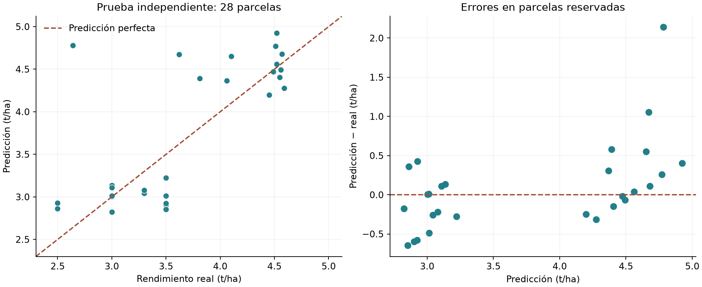
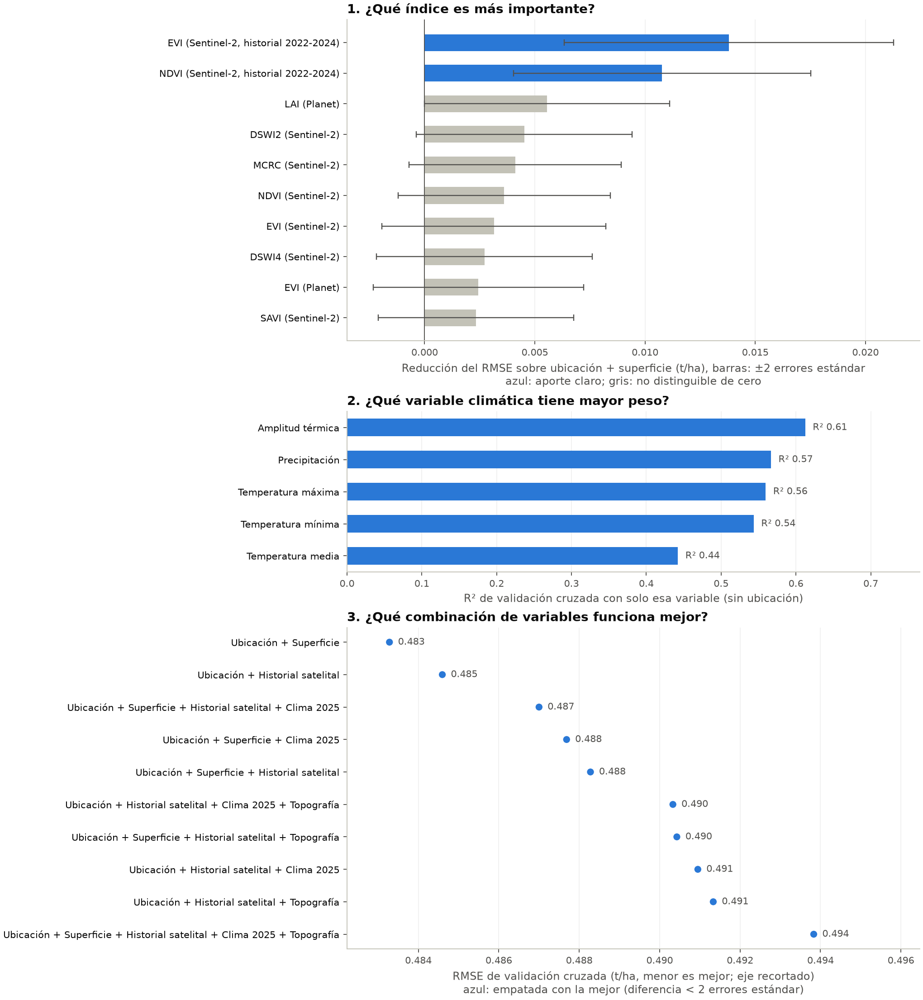

# Predicción del rendimiento de cebada

Se estimó el rendimiento, en toneladas por hectárea, del ciclo abril–octubre de 2025.
El programa integra las geometrías y la extracción existente con índices de Sentinel-2,
Landsat y Planet. Usa observaciones con nubosidad máxima 20%.
Las estadísticas topográficas de cobertura insuficiente se tratan como ausentes.

## Variables construidas

- Medianas mensuales de cada índice (abril–octubre) y sus resúmenes, como en la versión previa.
- **Fenología por parcela** para todos los índices de los tres sensores: curva suavizada
  (mediana móvil de 3 fechas) con pico, percentil 90, nivel base de abril–mayo, amplitud,
  día del pico, inicio y fin de temporada (50 % de la amplitud), duración e integrales.
- **Historial Sentinel-2 2022–2024** (NDVI y EVI: pico, base, integral y su media):
  describe la productividad habitual de cada parcela antes del ciclo evaluado.
- Coordenadas en km, indicadores de municipio (≥5 parcelas), superficie, clima y topografía.
  Ninguna de estas variables usa rendimientos; se calculan igual para las 197 parcelas.

## Modelo geográfico-residual

La exploración descriptiva mostró que el rendimiento depende sobre todo de la zona (municipio)
y que parcelas a menos de 0.5 km rinden parecido; el clima (~5 km) apenas cambia dentro de una
zona. Esa exploración (medias por municipio, semivariograma) usó las 138 parcelas etiquetadas;
las comparaciones de variables y modelos que guiaron este diseño usaron solo las 110 de
desarrollo. La prueba de 28 ya había sido consultada por la versión anterior del programa, así
que no es una prueba completamente nueva. Por eso se añadió un candidato que:
1) estima el efecto de zona con los vecinos más cercanos en km (ponderados por distancia);
2) corrige el residuo fuera de fold con Ridge usando la superficie y las métricas
   fenológicas más correlacionadas con ese residuo, elegidas dentro de cada fold.
Compite en igualdad con el resto de candidatos; la validación cruzada decide.

Variables del modelo final (coeficiente estandarizado del residuo):

- componente_0: `log_area_ha` (-0.010), `fenh_s2_evi_2022_base` (+0.062), `fenh_s2_ndvi_media_base` (+0.030), `fenh_s2_evi_2023_base` (+0.032)

## Diseño de evaluación

- 110 parcelas para desarrollo y 28 para prueba independiente.
- 5 folds × 3 repeticiones exclusivamente en desarrollo.
- Imputación, eliminación de constantes, selección de variables y escalado se ajustan dentro de cada fold.
- Se selecciona por RMSE, comparando modelos y promedios de familias distintas.
- La configuración se guarda en seleccion_congelada.json antes de consultar la prueba.
- La media del rendimiento de entrenamiento es la referencia mínima.
- Después de la prueba, el mismo algoritmo se reajusta con las 138 parcelas conocidas para las 59 ocultas.
- El modelo reajustado no tiene una segunda evaluación independiente; las métricas corresponden al modelo entrenado con el 80%.

Modelo seleccionado: **092_GeoResidual_fenologia**.
RMSE de selección interna: **0.4594 t/ha**.
Esta cifra puede ser optimista por selección entre candidatos; la prueba independiente es la evaluación principal.

## Resultado de la prueba reservada

| Métrica | Modelo elegido | Media de entrenamiento |
|---|---:|---:|
| RMSE (t/ha) | 0.5599 | 0.7739 |
| MAE (t/ha) | 0.3762 | 0.6750 |
| R² | 0.3484 | -0.2448 |
| Error porcentual absoluto medio (MAPE) | 11.30% | 20.85% |
| Predicciones con error relativo ≤10% | 64.29% | 14.29% |
| Predicciones con error relativo ≤20% | 92.86% | 64.29% |

Validación cruzada complementaria (configuración fija, 5×3, 138 parcelas):
RMSE 0.4751 t/ha, MAE 0.3412 t/ha,
R² 0.6861. Con 28 parcelas la prueba tiene un intervalo amplio; esta cifra
es más estable, aunque algo optimista porque incluye las parcelas que eligieron la configuración.

MAE expresa el error absoluto promedio por hectárea. RMSE penaliza más los errores grandes.
R² compara con la variabilidad real; no es un porcentaje de exactitud. MAPE es error relativo,
no debe transformarse en una supuesta «precisión» mediante 100 − MAPE.



Los rangos bootstrap de MAE/RMSE en metricas.json describen variabilidad al remuestrear
estas parcelas; no son intervalos de predicción ni corrigen dependencia espacial.

## Dependencia espacial

La partición aleatoria mide interpolación entre parcelas de las zonas entregadas.
Muchas comparten clima y ubicación próxima. El diagnóstico GroupKFold separa zonas
de 0.05° asignadas por centroide, usando únicamente el conjunto de desarrollo.
Parcelas que cruzan límites pueden compartir parte del clima por la extracción zonal.
No constituye una validación espacial anidada y no se utiliza para reajustar la elección.
RMSE espacial diagnóstico: 0.5349 t/ha.

## Intervalos de predicción

Semiamplitud conformal por zona, a partir de los residuos fuera de fold de las 138 parcelas
(municipios con ≥15 parcelas; el resto se agrupa). Cobertura aproximada, no garantizada:

| Zona | Parcelas | 80 % | 90 % |
|---|---:|---:|---:|
| Calpulalpan | 30 | ±0.56 | ±0.60 |
| Chignahuapan | 71 | ±0.62 | ±0.77 |
| Otros municipios | 21 | ±0.47 | ±0.73 |
| Singuilucan | 16 | ±0.49 | ±1.19 |
| Todas | 138 | ±0.55 | ±0.71 |

Los límites para cada parcela están en predicciones_59_intervalos.csv y resultados_para_mapa.csv.
Para un análisis de crédito, el límite inferior expresa un rendimiento conservador.

## Preguntas guía

Validación cruzada 5×4 sobre las 138 parcelas conocidas, ejecutada después de la prueba;
no modifica el modelo. Cada índice o variable se mide de dos formas:
**solo** (Ridge con sus métricas, sin ubicación) y **aporte sobre ubicación**: cuánto baja el RMSE
al añadir su mejor métrica, elegida dentro de cada fold, a la vecindad geográfica + superficie
(referencia: RMSE 0.493 t/ha, R² 0.666).



### 1. ¿Qué índice es más importante?

- Mayor poder por sí solo: **MSAVI (Planet)** (RMSE 0.695 t/ha, R² 0.336).
  Sin ubicación, los índices distinguen sobre todo zonas productivas.
- Mayor aporte sobre la ubicación, incluyendo el historial: **EVI (Sentinel-2, historial 2022-2024)**
  (+0.0138 ± 0.0075 t/ha).
- Mayor aporte entre los índices de la temporada 2025: **LAI (Planet)**
  (+0.0056 ± 0.0056 t/ha);
  métrica más asociada dentro del municipio: `fen_planet_lai_base`.
- Aportes mayores que dos errores estándar: EVI (Sentinel-2, historial 2022-2024), NDVI (Sentinel-2, historial 2022-2024).
  Los demás no se distinguen de cero con 138 parcelas.

| Índice | RMSE solo | R² solo | Aporte (t/ha) | Error estándar | Métrica más asociada | r intra-municipio |
|---|---:|---:|---:|---:|---:|---:|
| EVI (Sentinel-2, historial 2022-2024) | 0.605 | 0.496 | +0.0138 | 0.0037 | fenh_s2_evi_2022_base | +0.32 |
| NDVI (Sentinel-2, historial 2022-2024) | 0.624 | 0.465 | +0.0108 | 0.0034 | fenh_s2_ndvi_2022_base | +0.31 |
| LAI (Planet) | 0.745 | 0.235 | +0.0056 | 0.0028 | fen_planet_lai_base | +0.16 |
| DSWI2 (Sentinel-2) | 0.778 | 0.162 | +0.0045 | 0.0024 | fen_s2_dswi2_integral_total | +0.08 |
| MCRC (Sentinel-2) | 0.780 | 0.159 | +0.0041 | 0.0024 | fen_s2_mcrc_integral_total | +0.07 |
| NDVI (Sentinel-2) | 0.719 | 0.285 | +0.0036 | 0.0024 | fen_s2_ndvi_base | +0.26 |
| EVI (Sentinel-2) | 0.705 | 0.315 | +0.0031 | 0.0025 | fen_s2_evi_base | +0.21 |
| DSWI4 (Sentinel-2) | 0.785 | 0.149 | +0.0027 | 0.0024 | fen_s2_dswi4_dia_pico | +0.15 |
| EVI (Planet) | 0.703 | 0.318 | +0.0024 | 0.0024 | fen_planet_evi_dia_pico | +0.18 |
| SAVI (Sentinel-2) | 0.708 | 0.314 | +0.0023 | 0.0022 | fen_s2_savi_base | +0.23 |

Tabla completa: pregunta1_indices.csv.

### 2. ¿Qué variable climática tiene mayor peso?

**Amplitud térmica**: R² 0.612 por sí sola (RMSE 0.529 t/ha).
Su aporte una vez conocida la ubicación es -0.0006 t/ha: el clima
(celdas de ~5 km) distingue zonas, pero casi no varía entre parcelas vecinas.

| Variable | RMSE solo | R² solo | Aporte (t/ha) |
|---|---:|---:|---:|
| Amplitud térmica | 0.529 | 0.612 | -0.0006 |
| Precipitación | 0.560 | 0.567 | -0.0004 |
| Temperatura máxima | 0.565 | 0.560 | -0.0014 |
| Temperatura mínima | 0.575 | 0.543 | -0.0010 |
| Temperatura media | 0.637 | 0.442 | -0.0018 |

### 3. ¿Qué combinación de variables funciona mejor?

Se probaron las 63 combinaciones de bloques con Ridge y ExtraTrees.
La de menor RMSE fue **Ubicación + Superficie** (0.483 t/ha, Ridge).
14 combinaciones están estadísticamente empatadas con ella (diferencia pareada
< 2 errores estándar); la más simple con menor RMSE es
**Ubicación + Superficie**.
Presencia de cada bloque entre las empatadas: Historial satelital 11/14, Ubicación 11/14, Clima 2025 8/14, Superficie 8/14, Topografía 6/14, Satélite 2025 0/14.
El modelo geográfico-residual, que combina vecindad, superficie y métricas fenológicas
elegidas en cada fold, se compara con estos resultados en comparacion_cv.csv.

| Combinación | Ridge | ExtraTrees | Mejor | Empate |
|---|---:|---:|---:|---:|
| Ubicación + Superficie | 0.483 | 0.503 | 0.483 | sí |
| Ubicación + Historial satelital | 0.493 | 0.485 | 0.485 | sí |
| Ubicación + Superficie + Historial satelital + Clima 2025 | 0.499 | 0.487 | 0.487 | sí |
| Ubicación + Superficie + Clima 2025 | 0.488 | 0.507 | 0.488 | sí |
| Ubicación + Superficie + Historial satelital | 0.493 | 0.488 | 0.488 | sí |
| Ubicación + Historial satelital + Clima 2025 + Topografía | 0.500 | 0.490 | 0.490 | sí |
| Ubicación + Superficie + Historial satelital + Topografía | 0.499 | 0.490 | 0.490 | sí |
| Ubicación + Historial satelital + Clima 2025 | 0.497 | 0.491 | 0.491 | sí |
| Ubicación + Historial satelital + Topografía | 0.500 | 0.491 | 0.491 | sí |
| Ubicación + Superficie + Historial satelital + Clima 2025 + Topografía | 0.501 | 0.494 | 0.494 | sí |

Tabla completa: pregunta3_combinaciones.csv. Con 138 parcelas, las diferencias menores a dos
errores estándar (columnas EE_* de los CSV) no deben interpretarse como superioridad.

## Interpretación

importancia_variables.csv mide cuánto empeora el RMSE de validación al permutar conjuntamente
las variables de un índice o familia. Importancia positiva indica utilidad predictiva.
Se calcula únicamente en folds del conjunto de desarrollo. Es descriptiva, no causal;
la correlación entre índices puede repartir u ocultar importancia.

## Alcance y trazabilidad

El uso de datos hasta octubre permite una estimación al cierre del ciclo, no un pronóstico
anticipado. --mes-final limita las observaciones y obliga a volver a validar el nuevo modelo.
Los años históricos de clima, si se incorporan, aportan contexto y no etiquetas anuales.
El clima tiene resolución aproximada de 5 km y la topografía 120 m; la extracción no añade detalle.
Los 59 rendimientos ocultos se mantienen ausentes y nunca se usan para entrenar o evaluar.
Las predicciones no se recortan al rango observado de rendimientos ni se corrigen mirando la prueba.
El rendimiento futuro en otra campaña o región requiere datos y validación adicionales.

manifiesto.json registra versiones, parámetros, hashes de insumos y partición; calidad_datos.json
registra el tratamiento de datos. particion.csv identifica las parcelas de cada conjunto.
modelo_evaluacion.joblib conserva el modelo de 80%; modelo_final.joblib conserva el de todas las conocidas
y la tabla de intervalos. resultados_para_mapa.csv muestra, para parcelas con etiqueta, la estimación
de validación cruzada (sin ver su propio rendimiento), útil para comparar real y estimado en el mapa.

## Reproducir

```bash
.venv/bin/pip install -r requirements_prediccion.txt
.venv/bin/python predicción.py
```

Para recuperar predicciones del modelo guardado sin volver a buscar hiperparámetros:

```bash
.venv/bin/python predicción.py --modelo salidas_prediccion/modelo_final.joblib
```

No cambiar la semilla o configuración para buscar una prueba más favorable.
Una vez consultada, esta partición deja de ser una prueba nueva para futuras iteraciones.
La convocatoria permite IA y exige declarar dónde se utilizó y anexar los prompts.
El diseño y la implementación de este programa se realizaron con asistencia de Codex y de
Claude (Anthropic); los prompts están en registro_asistencia_IA.md.
Este reporte describe el componente analítico; la entrega del reto requiere además la interfaz,
el reporte técnico con la estructura de las bases y el video demostrativo.
